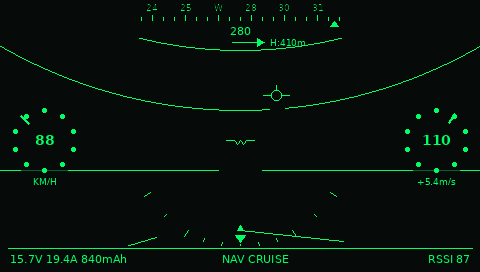

# FrSky ETHOS 1.6 Saab Gripen / PC-21 INAV HUD Widget (`v1.0.0-rc1`)

A high-performance vector HUD widget designed for the **FrSky Horus X12S (480×272 color TFT)** running **ETHOS 1.6**, inspired by the **Saab JAS 39 Gripen (EP-17)** concentric pitch ladder symbology combined with **F-22** circular dot dials and **PC-21** FPV reference.

**[🚀 Launch Live Interactive Horus X12S & Gripen HUD Simulator](https://YOUR_USERNAME.github.io/gripen-hud/)**  
*(Test the exact 480×272 ETHOS HUD directly in your browser using interactive Mode 2 gimbals and telemetry controls!)*

---

## Authors & Contributors
* **Lead Developer & Test Pilot:** Project Author
* **AI Collaborator & Code Architect:** Gemini

---

## Key Features
* **Hemispherical Gripen Pitch Ladder:** Straight level horizon ($0^\circ$), solid concentric circles centered on $+90^\circ$ Zenith for climb, and intermittent dashed concentric circles centered on $-90^\circ$ Nadir for dive.
* **Flattened Jet Zoom (`6.0 px/°` default):** Spacious, immersive arc separation optimized for the Horus X12S display.
* **Dual-Pole Full Cardinal Crosses:** Complete `N / S / E / W` direction ticks and labels at both vertical poles ($+90^\circ$ Zenith and $-90^\circ$ Nadir).
* **Cardinal Dive Triangles:** Exactly 4 horizon-pointing triangles per dive ring aligned strictly to the $90^\circ$ cardinal intervals ($0^\circ, 90^\circ, 180^\circ, 270^\circ$).
* **CPU View Frustum Culling:** Smooth $60\text{ fps}$ performance on the Horus X12S by rendering only pitch rings within $\pm 45^\circ$ of current aircraft attitude.
* **Semi-Transparent Instrument Backdrops:** Adjustable opacity circular clearings behind the dynamic Flight Path Vector (`-o-`) and 10-dot speed/altitude dials.
* **Built-in D16v2 Telemetry Simulator:** Test full flight attitudes directly on your radio without a bound receiver.

---

## Inflight Maneuvering Verification


---

## Installation on FrSky Horus X12S (ETHOS 1.6)
1. Copy the `SCRIPTS` folder from this repository to the root of your radio's SD card so the script resides at:
   ```text
   /SCRIPTS/WIDGETS/gripen_hud/main.lua
   ```
2. Power on your Horus X12S, open **Screens / Widgets**, and select **Gripen INAV HUD** on a full-screen layout.
3. Open **Configure Widget** to verify sensor mappings or enable the built-in telemetry simulator.

---

## INAV CLI Setup for FrSky D16v2 (S.Port)
To ensure dedicated pitch and roll frames transmit smoothly over SmartPort telemetry, run the following commands in the INAV Configurator CLI:
```text
set frsky_pitch_roll = ON
save
```

---

## License & Disclaimer
This project is licensed under the **GNU General Public License v3.0 (GPLv3)** — see the [LICENSE](LICENSE) file for details.

> **Model Aviation Disclaimer:** This software is provided *"as-is"* without warranty of any kind, intended strictly for hobbyist RC model aircraft use. The pilot in command remains solely responsible for safe operation.
